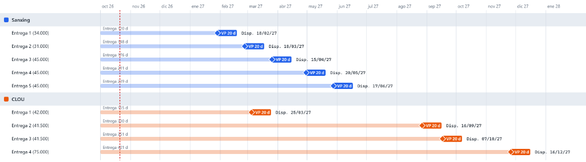
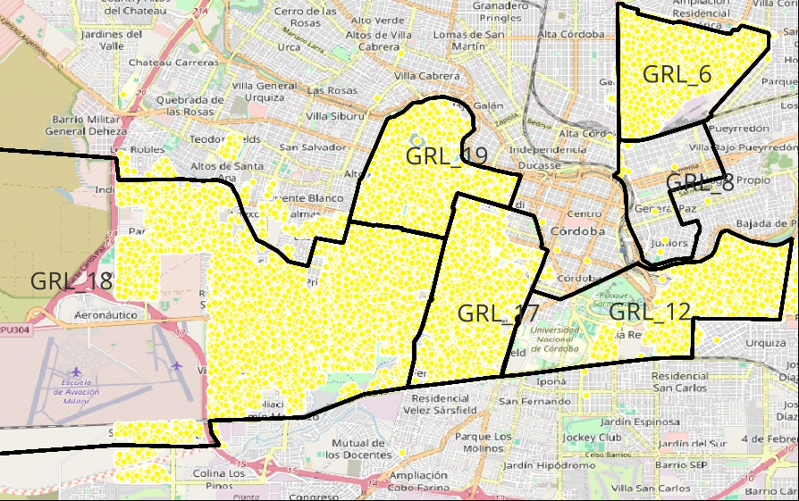

# ⚡ Despliegue Masivo de Medidores Inteligentes AMI - EPEC

[](https://www.epec.com.ar)
[]()
[]()
[]()
[]()
[](https://github.com/PROTELEM-EPEC)

Sistema centralizado de planificación, cronogramas de disponibilidad física (`Disp.`), curvas de avance con Verificación Primitiva (`VP 20d`), matriz de compatibilidad por Subestación Transformadora (SET) y plan de trabajo de cuadrillas en campo para el despliegue de **Infraestructura Avanzada de Medición (AMI)** en la Provincia de Córdoba.

---

## 📌 Resumen Ejecutivo de la Licitación N° 5573

| Orden de Provisión | Proveedor / Adjudicatario | Objeto de la Contratación | Cantidad Adjudicada | Monto Adjudicado | Plazo Límite / Condición |
| :---: | :--- | :--- | :---: | :---: | :---: |
| **OP 27131** | **SANFORD GLOBAL TRADE LLC** | Medidores Monofásicos + Trifásicos + Concentradores | 160.000 Mono + 40.000 Tri + 3.000 Concentradores | USD 11.688.100 ($17.315 M ARS) | 7 Entregas (DAP Ferreyra) |
| **OP 27133** | **NICEMA S.A.** | Medidores Monofásicos (PLC+GPRS) + Trifásicos + Concentradores | 160.000 Mono + 40.000 Tri + 3.000 Concentradores | USD 11.688.100 ($17.315 M ARS) | 4 Entregas (DAP Ferreyra) |
| **OP 27132** | **ROWING S.A.** | Mano de Obra, Normalización y Cambio de Medidor (USE) | 94.000 USE (25 cuadrillas mínimas) | $10.583.507.000 ARS (c/ IVA) | 25-01-2028 (Anexo D PET) |
| **OP 27134** | **CONECTAR S.R.L.** | Mano de Obra, Normalización y Cambio de Medidor (USE) | 94.000 USE (25 cuadrillas mínimas) | $10.583.507.000 ARS (c/ IVA) | 27-03-2028 (Anexo D PET) |
| **TOTALES** | **Consolidado AMI EPEC** | **Equipamiento + Mano de Obra** | **400.000 Medidores + 6.000 SET + 188.000 USE** | **$55.798.854.300 ARS** | **Despliegue 2027 - 2028** |

---

## 📅 Cronograma de Disponibilidad Real en Campo (`Disp.`)

Conforme a la **Resolución 247/2019 de la Secretaría de Comercio**, todo lote ingresado a Almacén Ferreyra debe superar el periodo de **Verificación Primitiva (VP = 20 días corridos)** para control metrológico de laboratorio antes de liberarse a las cuadrillas de campo.



### Curva de Disponibilidad por Lotes:

| Marca / Lote | Cantidad | Días Contractuales | Verificación Primitiva | Fecha Disponible en Campo (`Disp.`) | Destino Estratégico Asignado |
| :---: | :---: | :---: | :---: | :---: | :--- |
| **Sanxing E1** | **34.000** | 120 d | VP 20 d | **18/02/2027** | 🚀 **Arranque Despliegue**: Plan 18 (Capital) + San Francisco Lote 1 |
| **Sanxing E2** | **31.000** | 148 d | VP 20 d | **18/03/2027** | Completamiento San Francisco (28.000 puntos totales) |
| **CLOU E1** | **42.000** | 155 d | VP 20 d | **25/03/2027** | 🚀 **Arranque CLOU**: Plan 6 (Continuidad con Plan 4) |
| **Sanxing E3** | **45.000** | 176 d | VP 20 d | **15/04/2027** | Plan 17 (Zona Aérea) + extensiones |
| **Sanxing E4** | **45.000** | 211 d | VP 20 d | **20/05/2027** | Distrito Río Cuarto (13.000 puntos) |
| **Sanxing E5** | **45.000** | 239 d | VP 20 d | **17/06/2027** | Distrito Villa María (6.000 puntos) + Cierre 100% Sanxing |
| **CLOU E2** | **41.500** | 330 d | VP 20 d | **16/09/2027** | Plan 8 (Post-relevamiento de acometidas) |
| **CLOU E3** | **41.500** | 351 d | VP 20 d | **07/10/2027** | Plan 12 + Villa Allende (800) |
| **CLOU E4** | **75.000** | 421 d | VP 20 d | **16/12/2027** | Zona Centro Subterránea (Planes 14 y 15 GPRS) + Cierre Total |

---

## 🗺️ Mapa de Sectorización: Córdoba Capital (Zona A)



### Diagnóstico de Planes y Reglas de Compatibilidad:
1. **GRL_19**: Ya cuenta con casi **10.000 medidores NANSEN** instalados. Se debe mantener la homogeneidad con concentradores Nansen existentes mediante stock remanente o aislamiento riguroso por subestación (SET).
2. **GRL_6**: Último en ser relevado. Asignado a **CLOU** por colindancia y continuidad con el **Plan 4**.
3. **GRL_18**: Relevado al 100%. Asignado a **SANXING** para absorber el primer lote disponible el **18/02/2027**.
4. **GRL_17**: Relevado en red aérea. Requiere auditoría de acometidas en edificios y galerías subterráneas hacia el límite con Nueva Córdoba.
5. **GRL_12**: Relevado parcial. Requiere auditoría inmediata en la frontera con el Plan 17 para completarlo.
6. **GRL_8**: Posee subestaciones y parcelas dibujadas en GIS; **urgente relevamiento de campo de acometidas**.
7. **GRL_14 y 15 (Centro)**: 100% red subterránea (cámaras de transformación). Programado para el segundo semestre con medidores inteligentes GPRS y concentradores especiales.

---

## 🌾 Estado en Zona Interior de la Provincia

| Distrito | Puntos Relevados | Marca Recomendada | Lote de Stock | Acción Previa Requerida |
| :--- | :---: | :---: | :---: | :--- |
| **San Francisco** | **28.000** | **SANXING** | E1 y E2 (Feb-Mar 2027) | Dibujo de polígonos de plan por subestación |
| **Río Cuarto** | **13.000** | **SANXING** | E4 (Mayo 2027) | Dibujo de polígonos de plan por subestación |
| **Villa María** | **6.000** | **SANXING** | E5 (Junio 2027) | Dibujo de polígonos de plan por subestación |
| **Villa Allende** | **800** | **CLOU** | E1 (Abril 2027) | Integración con corredor Gran Córdoba |
| **TOTAL INTERIOR** | **47.800** | — | — | **Base relevada sólida lista para ejecutar** |

---

## 📦 Plan Maestro Contractual de Despliegue (360.000 Medidores Netos)

Con la aplicación de la **reserva técnica del 10%** (40.000 medidores en custodia en Almacén Ferreyra para garantías, roturas y amortiguación de `VP 20d`), el lote neto a instalar asciende a **360.000 medidores inteligentes** con fecha límite improrrogable al **25 de enero de 2028** (12 meses: Febrero 2027 a Enero 2028).

### Distribución Territorial Aprobada:
* **Zona A (Córdoba Capital)**: **316.980 medidores** (88,05%).
* **Interior de la Provincia**: **43.020 medidores** (11,95%):
  * **Río Cuarto**: **13.000 medidores** (**100% completo** de la cuenca asignada).
  * **San Francisco**: **24.154 medidores** (proporcional, Sanxing E1 + E2).
  * **Villa María**: **5.176 medidores** (proporcional, Sanxing E5).
  * **Villa Allende**: **690 medidores** (proporcional, CLOU E3).

### Regla de Relevamiento Anticipado ($\ge$ 15 días):
Todo frente de obra se releva con **1 mes de antelación** (Enero 2027 a Diciembre 2027), garantizando un colchón de 15 a 30 días con subestaciones **"SET OK"** antes de la llegada de las cuadrillas.

---

## 🛠️ Estructura del Repositorio

```
despliegue-medidores-inteligentes-ami/
├── README.md                                 # Memoria técnica y lineamientos contractuales
├── index.html                                # Tablero interactivo SPA ejecutivo
├── style.css                                 # Estilos ejecutivos Dark Mode
├── app.js                                    # Lógica interactiva de simulación y filtros
├── data/
│   ├── cronograma_entregas_ami.json          # Matriz de entregas, VP y fechas disponibles
│   ├── diagnostico_planes_capital.json       # Datos por plan de Capital
│   ├── relevamiento_interior.json            # Puntos censados por distrito interior
│   ├── conteo_medidores_mi_sigec.csv         # Universo de suministros SIGEC
│   ├── tasas_instalacion_relevamiento.json   # Tasas reales históricas de campo
│   ├── simulacion_equilibrio_zona_a.csv      # Simulación de equilibrio Zona A
│   └── plan_maestro_despliegue_360k.csv      # Plan Maestro Contractual mensual y acumulado
├── docs/
│   ├── 01_analisis_licitacion_5573_ordenes_provision.md
│   ├── 02_metodologia_despliegue_set_concentradores_plc.md
│   ├── 03_compatibilidad_marcas_y_fronteras_electricas.md
│   ├── 04_plan_de_accion_cuadrillas_y_relevamientos.md
│   ├── 05_equilibrio_relevamiento_instalacion_stock_zona_a.md
│   ├── 06_plan_maestro_despliegue_contractual_360k.md
│   └── licitacion_5573/                      # Pliegos y OPs oficiales en PDF
├── scripts/
│   ├── consulta_sigec_medidores_mi_telemedibles.sql
│   ├── analisis_tasas_instalacion_relevamiento.py
│   ├── simulacion_equilibrio_zona_a.py
│   └── plan_maestro_despliegue_360k.py
└── assets/img/                               # Cartografía GIS y gráficos Gantt
```

---

*© 2026 EPEC · PROTELEM · Gerencia de Distribución · División Medidores y Conexiones.*
