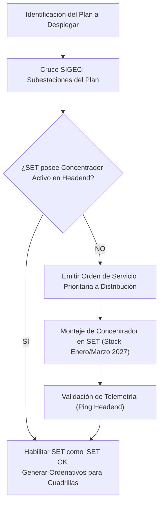

# Protocolo de Despliegue: Subestación Transformadora (SET) y Concentrador PLC

## 1. Principio Fundamental de Operación AMI PLC
Los medidores inteligentes residenciales y comerciales de baja tensión transmiten sus paquetes de telelectura, curvas de carga y alarmas de apertura de tapa/corte mediante modulación por corrientes portadoras sobre la línea de potencia (PLC - Power Line Communication).

El receptor y decodificador obligado es el **Concentrador de Datos de Subestación**, instalado físicamente en el tablero de baja tensión de la SET.

## 2. La Regla del "SET OK"
> **DIRECTIVA OPERATIVA**: Queda prohibido emitir lotes de ordenativos de cambio de medidor en suministros dependientes de una Subestación que no figure en estado **"SET OK"** (Concentrador instalado, parametrizado, con enlace 4G/GPRS activo hacia el Headend de EPEC).

### Consecuencias de vulnerar la regla:
1. Medidor mudo en campo sin capacidad de reportar telemetría.
2. Inconsistencia entre lectura física y lectura comercial en SIGEC.
3. Imposibilidad de ejecutar cortes remotos por mora o reconexiones.
4. Necesidad de re-enviar cuadrillas de verificación.

## 3. Circuito de Validación de SETs

