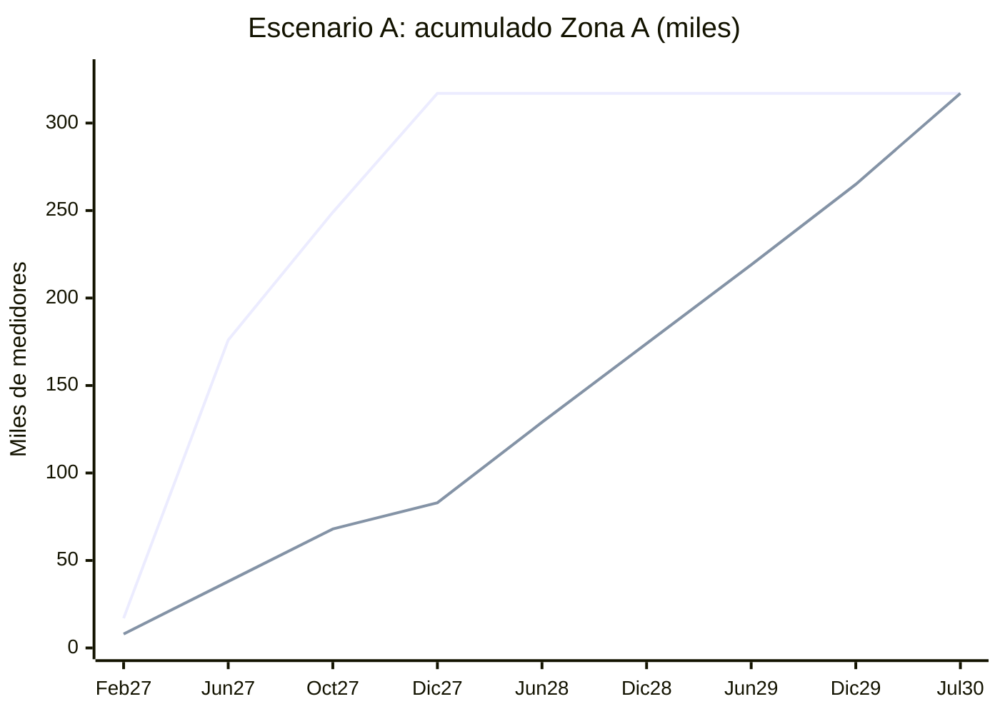

# Equilibrio Relevamiento vs. Instalación vs. Stock: Zona A (Lic. 5573)

> [!NOTE]
> **Fase 4: Prueba piloto, pendiente de tu aprobación.** Los datos salen de Oracle (snapshot del 23/10/2026).
> Scripts: [analisis_tasas_instalacion_relevamiento.py](file:///C:/Users/jidiaz/.gemini/antigravity-ide/scratch/despliegue-medidores-inteligentes-ami/scripts/analisis_tasas_instalacion_relevamiento.py) · [simulacion_equilibrio_zona_a.py](file:///C:/Users/jidiaz/.gemini/antigravity-ide/scratch/despliegue-medidores-inteligentes-ami/scripts/simulacion_equilibrio_zona_a.py)

## 1. Tasa de instalación (Nov-2025 a Abr-2026)

Fuente: `XXSIGEC.EQUIPOS.EQP_FECHA_INSTAL` ⨝ `STOCK_EQUIPOS.STE_MARCA IN ('CLOU','NSEN')`. Son las marcas de los suministros con `srv_telemedible` = SI/SN. Se cuentan suministros distintos.

| Mes | Zona A | Interior | Total |
|---|---:|---:|---:|
| 2025-11 | 9.637 | 103 | 9.740 |
| 2025-12 | 7.655 | 81 | 7.736 |
| 2026-01 | 5.112 | 114 | 5.226 |
| 2026-02 | 6.173 | 102 | 6.275 |
| 2026-03 | 8.424 | 205 | 8.629 |
| 2026-04 | 8.354 | 78 | 8.432 |
| **Promedio mensual** | **7.559** | **114** | **7.673** |

- El 98,5 % de lo instalado es CLOU. Nansen aporta entre 100 y 230 por mes.
- Ene-Feb bajan cerca de un 30 % (receso estival). Mar-Abr vuelven a unos 8.400 por mes.

## 2. Tasa de relevamiento en Zona A (`georef.relevamiento`, `rel_subestacion LIKE '1000-%'`)

Se cuenta `COUNT(DISTINCT rel_medidor_id)` por mes de `REL_FECHA_ALTA`.

| Ventana | Promedio mensual |
|---|---:|
| **Nov-2025 a Abr-2026 (mismo período del despliegue)** | **3.620** |
| May-2026 a Sep-2026 (reciente) | 4.338 |
| Abr-2023 a Oct-2026 (histórico, 43 meses) | ~5.700 |

**Estado de lo relevado en Zona A (hoy):**

| Estado | Medidores |
|---|---:|
| Ya telemedido (SI/SN) | 83.452 |
| **Relevado pendiente de instalar (backlog)** | **162.156** |

## 3. Stock de Zona A según las entregas publicadas (neto de Interior y de la reserva del 10 %)

| Lote | Disp. | Bruto | Cupo Zona A | **Neto 90 %** |
|---|---|---:|---:|---:|
| Sanxing E1 | Feb-27 | 34.000 | 19.354 | 17.419 |
| Sanxing E2 | Mar-27 | 31.000 | 17.646 | 15.881 |
| CLOU E1 | Mar-27 | 42.000 | 42.000 | 37.800 |
| Sanxing E3 | Abr-27 | 45.000 | 45.000 | 40.500 |
| Sanxing E4 | May-27 | 45.000 | 32.000 | 28.800 |
| Sanxing E5 | Jun-27 | 45.000 | 39.000 | 35.100 |
| CLOU E2 | Sep-27 | 41.500 | 41.500 | 37.350 |
| CLOU E3 | Oct-27 | 41.500 | 40.700 | 36.630 |
| CLOU E4 | Dic-27 | 75.000 | 75.000 | 67.500 |
| **Total** | | **400.000** | **352.200** | **316.980** |

## 4. Simulación mensual del equilibrio

En cada mes se instala lo menor entre tres valores: la capacidad de instalación, el stock disponible y el backlog relevado.

| Escenario | Instalación/mes | Relevamiento/mes | **Fin del despliegue Zona A** | Restricción dominante | Pico de stock ocioso |
|---|---:|---:|---|---|---:|
| **A: Ritmo histórico** | 7.559 | 3.620 | **Jul-2030** (42 meses) | Mano de obra | **233.829** (Dic-27) |
| B: Relevamiento reciente | 7.559 | 4.338 | Jul-2030 | Mano de obra | 233.829 |
| C: Ritmo requerido | **26.415** | **12.902** | Feb-2028 | Stock (Feb, Ago y Nov-27) | 52.421 |

*Línea superior: stock neto acumulado recibido. Línea inferior: instalado acumulado al ritmo histórico.*

## 5. Conclusiones

1. **El relevamiento no es el cuello de botella al ritmo actual.** El backlog de 162 mil relevados cubre unos 21 meses de instalación. El backlog cae unos 3.900 por mes (7.559 − 3.620) y todavía quedan unos 40 mil cuando se termina de instalar.
2. **La restricción dominante es la mano de obra de instalación.** Al ritmo de 7.559 por mes:
   - Zona A recién se cierra en **Jul-2030**.
   - El plazo de las OP 27132/27134 vence el **25-01-2028**. Para esa fecha se habrán instalado solo unos **90.700** de 316.980 (29 %).
   - En **Dic-2027** quedarían **~234 mil medidores ociosos** en Ferreyra, además de los 40 mil de reserva.
3. **Ritmo necesario para cumplir el plazo (12 meses, Feb-27 a Ene-28):**
   - Instalación: **~26.400 por mes**, unas 3,5 veces lo histórico. Es coherente con 50 cuadrillas (~25 instalaciones por cuadrilla y por día hábil).
   - Relevamiento: **~12.900 por mes**, unas 3,6 veces lo histórico. Sin esa suba, el backlog se agota hacia **Oct/Nov-2027** y el relevamiento pasa a ser la restricción.
   - Aun a ese ritmo hay meses de **falta de stock** (Feb, Ago y Nov-2027), por el hueco de entregas entre Jun y Sep-2027.

## 6. Supuestos y limitaciones (a validar)

- El cupo de San Francisco (28 mil) se reparte en proporción entre Sanxing E1 y E2. El resto del Interior se descuenta según el destino publicado.
- Se toma el backlog de hoy como inicial. No se modela que las cuadrillas actuales sigan consumiéndolo antes de Feb-2027. Si lo hacen, el relevamiento se vuelve restrictivo antes.
- No se modela la regla **SET OK** (concentradores montados). Puede reducir el backlog que realmente se puede instalar.
- El backlog toma como "pendiente" todo suministro relevado no telemedible, sin filtrar por plan asignado a la licitación.
- Oct-2026 es un mes parcial (hasta el 23/10) y queda excluido de los promedios.
