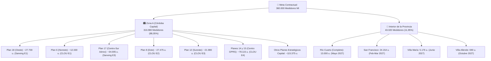

# ⚡ Plan Maestro Contractual de Despliegue AMI (360.000 Medidores)

> **Documento de Ingeniería N° 06**  
> **Proyecto**: Plan Maestro de Despliegue de Medidores Inteligentes AMI y Concentradores PLC  
> **Organización**: `PROTELEM-EPEC` · Licitación Pública N° 5573 / OP 27131 a 27134  
> **Fecha de Emisión**: 23 de Octubre de 2026  
> **Estado**: Plan Operativo Validado para Cumplimiento de Plazo Contractual (25-01-2028)

---

## 🎯 1. Bases Operativas y Parámetros Contractuales

1. **Plazo Límite Contractual**: **25 de enero de 2028** (Conforme Anexo D PET de las OP 27132 y OP 27134 de mano de obra).
2. **Ventana de Instalación en Campo**: **12 meses corridos** (Febrero 2027 a Enero 2028), iniciando tras la disponibilidad física del primer lote (Sanxing E1 disponible el 18/02/2027 tras 20 días de Verificación Primitiva `VP 20d`).
3. **Volumen Total a Instalar**: **360.000 medidores inteligentes (MI)** (400.000 adjudicados brutos descontando el 10% de reserva operativa en Almacén Central Ferreyra = 40.000 u.).
4. **Proporción Territorial**:
   * **Zona A (Córdoba Capital)**: **316.980 medidores** (88,05% del total).
   * **Interior de la Provincia**: **43.020 medidores** (11,95% del total).
5. **Distribución del Cupo del Interior**:
   * **Río Cuarto**: **13.000 medidores** (**100% completo** de la cuenca estratégica adjudicada).
   * **San Francisco**: **24.154 medidores** (proporcional al relevamiento base de 28k).
   * **Villa María**: **5.176 medidores** (proporcional al relevamiento base de 6k).
   * **Villa Allende**: **690 medidores** (proporcional al relevamiento base de 800).
6. **Regla de Relevamiento Anticipado**: Todo frente de trabajo a instalar debe encontrarse **100% relevado en catastro con un mínimo de 15 días de antelación** (ejecución programada con 1 mes de adelanto respecto al mes de instalación: Enero 2027 a Diciembre 2027).

---

## 📊 2. Simulación de Despliegue Mensual y Acumulado (Instalación vs. Relevamiento vs. Stock)

| Mes Inst. | Mes Relev. Previo | Stock Neto Recibido | Stock Neto Acumulado | Inst. Zona A | Inst. Interior | **Inst. Total Mes** | **Inst. Total Acum.** | **Stock Almacén Disp.** | Relev. Zona A | Relev. Interior | **Relev. Total Mes** | **Relev. Total Acum.** | Distrito Interior | Plan Estratégico Zona A |
| :---: | :---: | :---: | :---: | :---: | :---: | :---: | :---: | :---: | :---: | :---: | :---: | :---: | :--- | :--- |
| **Feb-27** | *Ene-27* | 30.600 | 30.600 | 17.500 | 12.500 | **30.000** | **30.000** | 600 | 17.500 | 12.500 | **30.000** | **30.000** | San Francisco L1 | Plan 18 (Oeste) - Arranque |
| **Mar-27** | *Feb-27* | 65.700 | 96.300 | 18.346 | 11.654 | **30.000** | **60.000** | 36.300 | 18.346 | 11.654 | **30.000** | **60.000** | San Francisco L2 | Plan 18 Cierre + Plan 6 |
| **Abr-27** | *Mar-27* | 40.500 | 136.800 | 30.000 | 0 | **30.000** | **90.000** | 46.800 | 30.000 | 0 | **30.000** | **90.000** | - | Plan 17 (Centro-Sur Aéreo) |
| **May-27** | *Abr-27* | 40.500 | 177.300 | 17.000 | 13.000 | **30.000** | **120.000** | 57.300 | 17.000 | 13.000 | **30.000** | **120.000** | **Río Cuarto (Comp.)** | Capital Cuencas Densas |
| **Jun-27** | *May-27* | 40.500 | 217.800 | 24.824 | 5.176 | **30.000** | **150.000** | 67.800 | 24.824 | 5.176 | **30.000** | **150.000** | **Villa María** | Capital Cuencas Densas |
| **Jul-27** | *Jun-27* | 0 | 217.800 | 30.000 | 0 | **30.000** | **180.000** | 37.800 | 30.000 | 0 | **30.000** | **180.000** | - | Plan 17 Remanente / Otros |
| **Ago-27** | *Jul-27* | 0 | 217.800 | 30.000 | 0 | **30.000** | **210.000** | 7.800 | 30.000 | 0 | **30.000** | **210.000** | - | Capital Continuidad |
| **Sep-27** | *Ago-27* | 37.350 | 255.150 | 30.000 | 0 | **30.000** | **240.000** | 15.150 | 30.000 | 0 | **30.000** | **240.000** | - | Plan 8 (Este CLOU E2) |
| **Oct-27** | *Sep-27* | 37.350 | 292.500 | 29.310 | 690 | **30.000** | **270.000** | 22.500 | 29.310 | 690 | **30.000** | **270.000** | **Villa Allende** | Plan 12 (Sureste CLOU E3) |
| **Nov-27** | *Oct-27* | 0 | 292.500 | 22.500 | 0 | **22.500** | **292.500** | 0 | 22.500 | 0 | **22.500** | **292.500** | - | Capital Continuidad Stock |
| **Dic-27** | *Nov-27* | 67.500 | 360.000 | 33.750 | 0 | **33.750** | **326.250** | 33.750 | 33.750 | 0 | **33.750** | **326.250** | - | Planes 14 y 15 (Centro GPRS) |
| **Ene-28** | *Dic-27* | 0 | 360.000 | 33.750 | 0 | **33.750** | **360.000** | 0 | 33.750 | 0 | **33.750** | **360.000** | - | Planes 14 y 15 (Cierre Final) |
| **TOTAL** | - | **360.000** | - | **316.980** | **43.020** | **360.000** | **360.000** | - | **316.980** | **43.020** | **360.000** | **360.000** | - | **100% Contractual Cumplido** |

---

## 🗺️ 3. Desglose Estratégico Territorial

---

## 🔍 4. Aspectos Clave de Cumplimiento Técnico

1. **Inexistencia de Quiebres de Stock**:
   * Gracias a la acumulación de stock neto en Almacén Ferreyra durante el primer semestre (pico de 67.800 unidades en Junio 2027), las cuadrillas de instalación operan sin interrupciones durante el receso de entregas de Julio y Agosto de 2027.
   * En Noviembre 2027 se modula la instalación a 22.500 unidades para consumir exactamente el stock disponible antes del ingreso de la entrega masiva de Diciembre (CLOU E4, 67.500 u.).
2. **Garantía de Relevamiento Previo (Antelación $\ge$ 15 días)**:
   * El cronograma de relevamiento inicia en **Enero 2027** y finaliza en **Diciembre 2027**, manteniendo siempre **1 mes completo (30 días)** de frente de trabajo ya validado y cargado en SIGEC Catastro antes de que las cuadrillas de colocación ingresen a cada zona.
   * Se elimina todo riesgo de "cuadrilla parada por falta de relevamiento".
3. **Reserva Operativa Preservada (40.000 Medidores)**:
   * Los 40.000 equipos del 10% de reserva quedan custodiados en Almacén Central Ferreyra (20.000 Sanxing y 20.000 CLOU) para atender contingencias, garantías de 36 meses y reposiciones sin alterar este cronograma.
